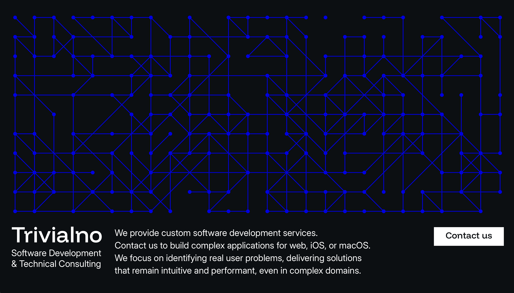

# Trivialno

Source for [trivialno.com](https://trivialno.com), the website of Trivialno,
a software development and technical consulting company based in Montenegro.

Plain HTML, CSS and JavaScript, with no framework, build step or dependencies.

## What's inside

- **Generative hero.** A canvas animation draws a new random graph of nodes and
  edges on every load. Click it to generate another.
- **Fluid layout.** CSS Grid with fluid typography and spacing, from small
  phones to wide desktops.

## Running locally

    python3 -m http.server 8000

Then open http://localhost:8000. A server is needed because the scripts are ES modules.

## License

© Trivialno DOO. All rights reserved.
